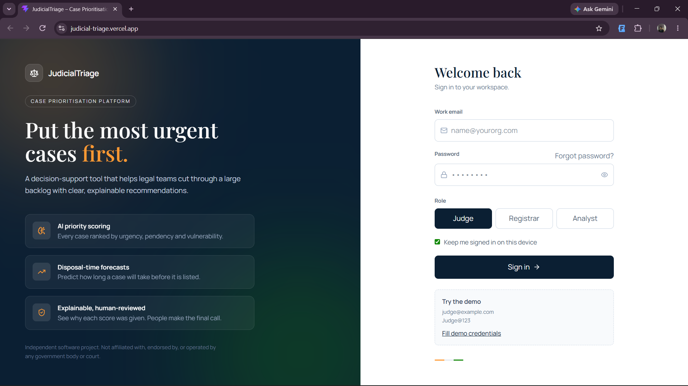
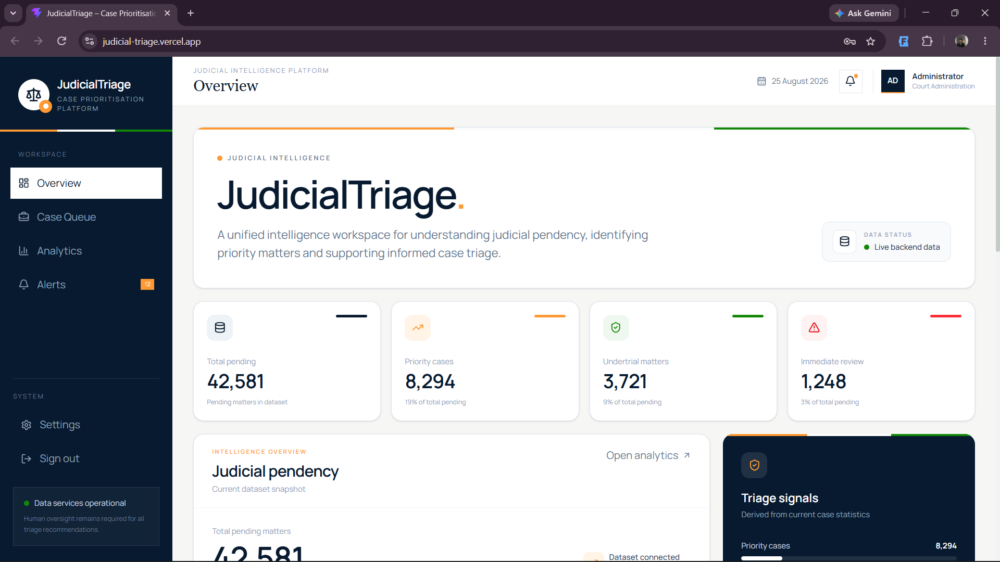
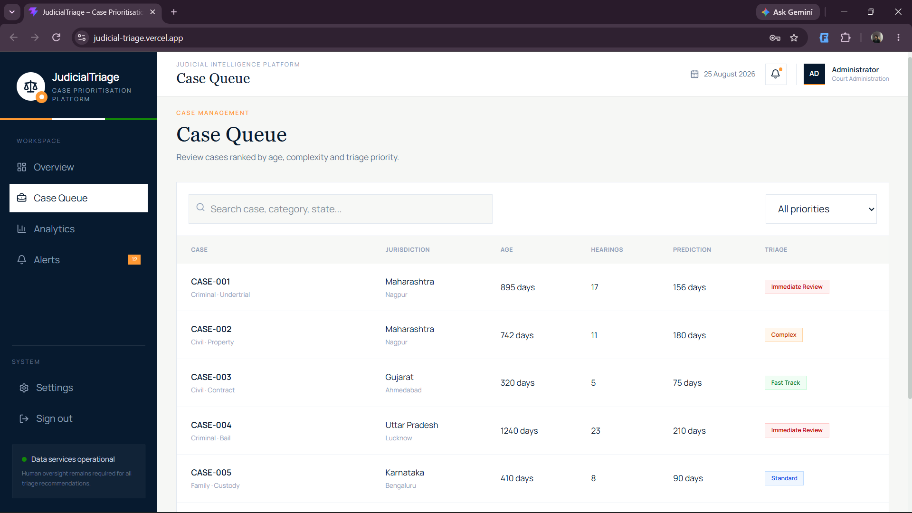
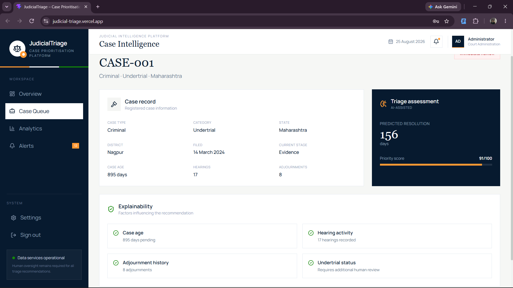
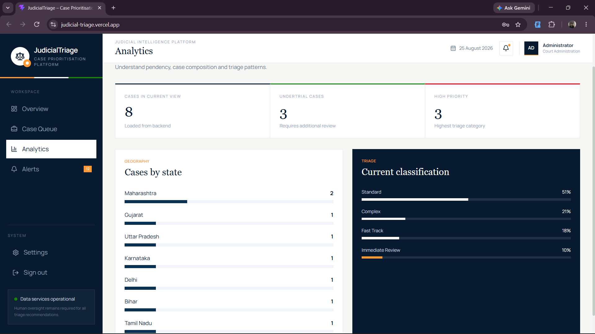
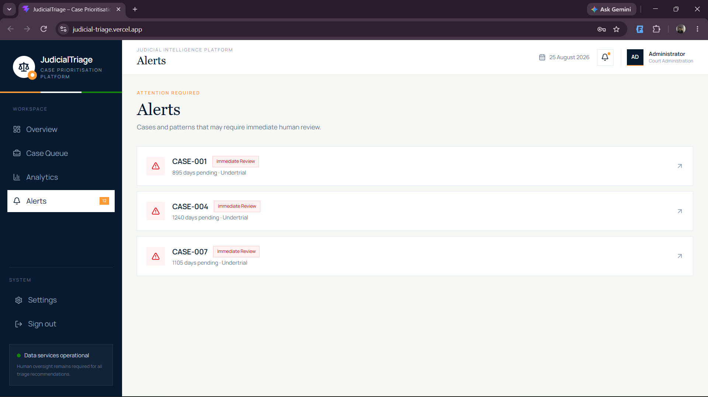

<div align="center">


# ⚖️ JudicialTriage

**AI-assisted case prioritisation dashboard with explainable, human-reviewed recommendations.**


[Features](#-features) · [Screenshots](#-screenshots) · [Quick start](#-quick-start) · [API](#-backend-api) · [Deploy](#-deployment) · [Roadmap](#-roadmap)

</div>

---

## 📖 Overview

Large case backlogs make it hard to know what should be heard first. **JudicialTriage** is a decision-support dashboard that scores each pending case by urgency, estimates how long it will take to resolve, and shows *why* a case was ranked the way it was.

The system only **recommends**. A person reviews every score and makes the final decision (human-in-the-loop).

> ⚠️ **Disclaimer:** This is an independent software project. It is not affiliated with, endorsed by, or operated by any government body or court. Do not use it as the sole basis for any legal or administrative decision.

## ✨ Features

- 🔐 **Sign-in screen** with role selection (Judge, Registrar, Analyst) and sign-out
- 📊 **Overview dashboard** with headline metrics, backlog trends and priority breakdowns
- 🗂️ **Case queue** with live search and priority filters
- 🔍 **Case detail view** with a plain-language explanation of each AI score
- 📈 **Analytics** for backlog trajectory and case-type distribution
- 🔔 **Alerts** for cases that need immediate review
- ⚙️ **Settings** for platform configuration and governance controls
- 📱 **Responsive** layout with a mobile menu
- 🧪 **Demo mode** that falls back to sample data when no backend is running

## 🖼️ Screenshots

> Add your images to `docs/screenshots/` using the file names below.

| Login | Overview |
|:---:|:---:|
|  |  |

| Case queue | Case details |
|:---:|:---:|
|  |  |

| Analytics | Alerts |
|:---:|:---:|
|  |  |

<details>
<summary>📱 Mobile view</summary>

<p align="center">
  
</p>

</details>

## 🧰 Tech stack

| Layer | Technology |
|---|---|
| UI | React 19, Vite 8 |
| Styling | Tailwind CSS 4 |
| Charts | Recharts |
| Icons | Lucide React |
| Backend (separate) | FastAPI, machine-learning model |
| Linting | oxlint |

## 📁 Project structure

```text
judicial-triage/
├── public/                # Static assets (favicon, icons)
├── src/
│   ├── pages/
│   │   ├── Login.jsx      # Sign-in screen
│   │   └── Overview.jsx   # Dashboard overview
│   ├── App.jsx            # App shell, navigation and page views
│   ├── demoData.js        # Sample data used when the API is offline
│   ├── index.css          # Tailwind import and global styles
│   └── main.jsx           # Entry point
├── .env.example           # Environment variable template
├── netlify.toml           # Netlify build settings
├── vercel.json            # Vercel build settings
└── vite.config.js
```

## 🚀 Quick start

**Requirements:** Node.js 20 or newer.

```bash
# 1. Clone
git clone https://github.com/tanmay-maxin/Judicial-AI-Triage.git
cd Judicial-AI-Triage

# 2. Install
npm install

# 3. (Optional) configure the backend URL
cp .env.example .env

# 4. Run
npm run dev
```

Open <http://localhost:5173>.

**Demo login**

| Email | Password |
|---|---|
| `judge@example.com` | `Judge@123` |

### Scripts

| Command | What it does |
|---|---|
| `npm run dev` | Start the development server |
| `npm run build` | Create a production build in `dist/` |
| `npm run preview` | Preview the production build locally |
| `npm run lint` | Lint the code with oxlint |

## 🔧 Configuration

Create a `.env` file (see `.env.example`):

| Variable | Default | Description |
|---|---|---|
| `VITE_API_URL` | `http://127.0.0.1:8000` | Base URL of the FastAPI backend |
| `VITE_DEMO_FALLBACK` | `true` | Set to `false` to stop using sample data when the API is unreachable |

## 🔌 Backend API

The dashboard calls one endpoint:

```http
GET {VITE_API_URL}/api/cases
```

Expected response:

```json
{
  "total": 42581,
  "priority": 8294,
  "undertrial": 3721,
  "immediate_review": 1248,
  "cases": [
    {
      "id": "CASE-001",
      "type": "Criminal",
      "category": "Undertrial",
      "state": "Maharashtra",
      "district": "Nagpur",
      "age": 895,
      "hearings": 17,
      "parties": 4,
      "predicted": 156,
      "score": 91,
      "priority": "Immediate Review",
      "undertrial": true,
      "stage": "Evidence",
      "filed": "14 March 2024",
      "adjournments": 8
    }
  ]
}
```

Remember to enable **CORS** for your frontend domain and serve the API over **HTTPS** in production.

## ☁️ Deployment

**Vercel**
1. Import the repository.
2. Framework preset: **Vite** (build `npm run build`, output `dist`).
3. Add `VITE_API_URL` (and `VITE_DEMO_FALLBACK=false`) under *Environment Variables*.
4. Deploy.

**Netlify**: import the repository. `netlify.toml` already sets the build command and publish folder.

**Any static host**: run `npm run build` and upload the `dist/` folder.

## 🔒 Security notes

- The current sign-in is a **front-end demo only**. Credentials live in `src/pages/Login.jsx`. Replace it with real authentication from your backend before using real data.
- Never commit `.env` files or secrets.
- Keep sample data off in production (`VITE_DEMO_FALLBACK=false`).

## 🗺️ Roadmap

- [ ] Real authentication (JWT or session based)
- [ ] Connect the trained ML model for live scoring
- [ ] Explainability charts (feature contributions per case)
- [ ] Reviewer actions: approve, escalate, downgrade, with an audit log
- [ ] CSV / Excel upload of case data
- [ ] Multi-language interface
- [ ] Automated tests and CI

## 🤝 Contributing

Contributions are welcome.

1. Fork the repository
2. Create a branch: `git checkout -b feature/my-feature`
3. Commit your changes: `git commit -m "Add my feature"`
4. Push: `git push origin feature/my-feature`
5. Open a pull request

## 📄 License

Add a `LICENSE` file (for example MIT) to state how others may use this project.

## 👤 Author

**Tanmay** · [@tanmay-maxin](https://github.com/tanmay-maxin)

---

<div align="center">

If you find this project useful, please consider giving it a ⭐

</div>
